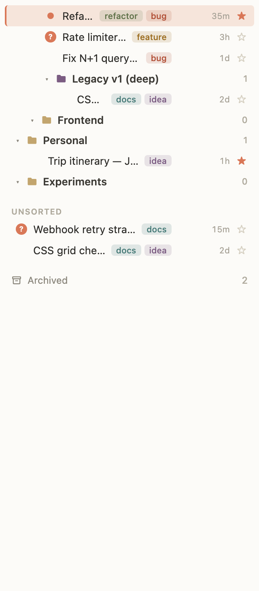

# Claude Code Nest

Organize your Claude Code chat history in VS Code: folders, tags, stars, search and archive in one sidebar panel.

[](https://github.com/jakemismas/claude-code-nest/actions/workflows/ci.yml)
[](LICENSE)

<p align="center">
  <picture>
    <source type="image/svg+xml" srcset="media/readme/robin.svg">
    
  </picture>
</p>

<p align="center">
  
</p>

## Features

- **Folders** with nesting and colors. Each chat has one home folder.
- **Tags** with colors. A chat can have as many as you like.
- **Stars** to pin the chats you come back to.
- **Search** across titles and full message text, with snippets.
- **Archive** chats out of the way, and keep a copy that survives Claude Code's own cleanup.
- **Unread and question markers** that show which chats have a new reply, and which reply asks you something.
- **Export** a chat to Markdown or JSON, and back up your whole library as JSON.
- **Open in Claude Code** with a click, or start a new session from the panel.

## Requirements

- VS Code 1.66 or later.
- The Claude Code extension, which creates the chats Nest organizes.

## Install

1. Download the latest `.vsix` file from [GitHub Releases](https://github.com/jakemismas/claude-code-nest/releases).
2. Install it with either method:
   - Run `code --install-extension <file>.vsix`.
   - In VS Code, open the Extensions view, choose **...** > **Install from VSIX**, and pick the file.

## Usage

1. Click the Claude Code Nest icon in the Activity Bar. The panel lists the chats for the current workspace.
2. Create a folder with the **+** next to Folders, then drag chats onto it. Right-click a chat to add tags, star it, export it or archive it.
3. Type in the search box to filter by title or message text. Click a tag chip to filter by tag.
4. Click a chat to open it in Claude Code.

## Commands

Run these from the Command Palette (prefix **Claude Code Nest:**) or from the panel.

- **Refresh** rescans your chats.
- **New Folder** and **New Tag** create a folder or tag.
- **Link to Chat...** and **Unlink** relate one chat to another.
- **Settings** opens the in-panel settings.
- **Export Library to JSON...** and **Import Library from JSON...** back up and restore your folders, tags and stars.
- **Show Token Cost Rollup** reports token totals by folder and tag.

## Settings

| Setting | Default | Description |
| --- | --- | --- |
| `claudeNest.archiveKeepWindowDays` | `30` | Days Nest keeps its copy of an archived chat before pruning it. Starred chats are always kept. Use `0` to never prune. Allowed values: 7, 30, 90, 0. |

Auto-archive and sort options are in the gear menu inside the panel.

## Privacy and safety

- Nest only reads your chat transcripts. It never writes under `~/.claude/projects`.
- Nest makes no network requests and collects no telemetry.
- Your folders, tags and stars stay in VS Code storage on your machine. They sync only if you use VS Code Settings Sync.

## Development

```sh
npm ci
npm test                  # lint, compile and unit tests
npm run test:integration  # tests inside a real VS Code instance
npm run fidelity          # screenshots of the panel with made-up data
npm run package           # build a .vsix
```

See [docs/architecture.md](docs/architecture.md) for how the code fits together.

## Contributing

Bug reports and pull requests are welcome. Read [CONTRIBUTING.md](CONTRIBUTING.md) first.

## License

[MIT](LICENSE). Third-party components are listed in [THIRD-PARTY-NOTICES.md](THIRD-PARTY-NOTICES.md).

Claude Code Nest is an independent project. It is not affiliated with or endorsed by Anthropic.
