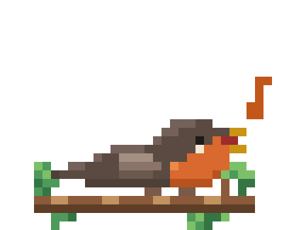
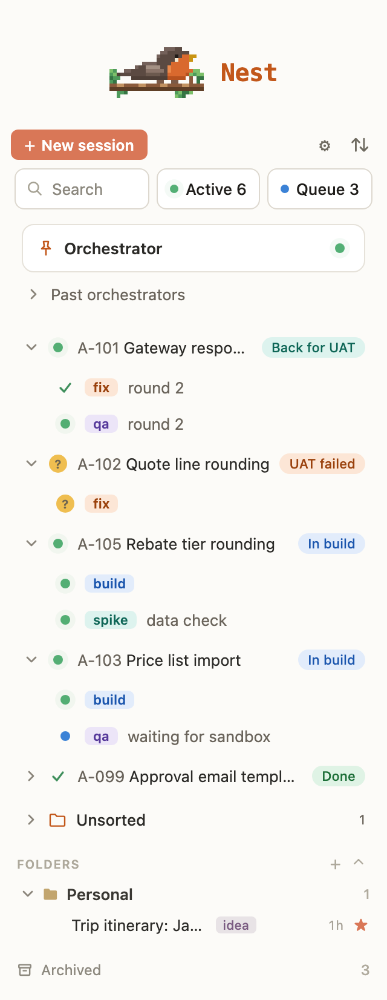
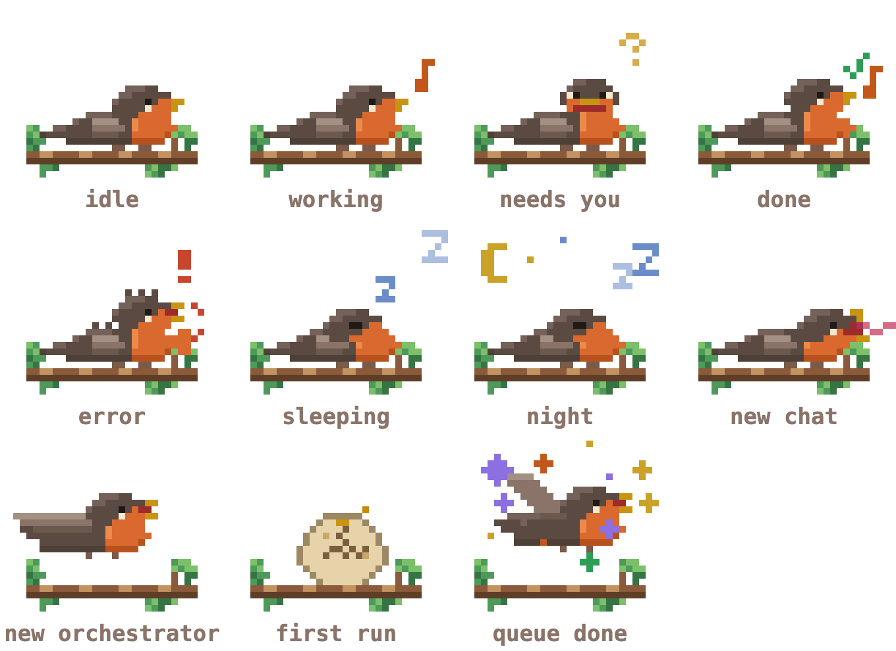

# Claude Code Nest

Organize your Claude Code chat history in VS Code: folders, tags, stars, search and archive in one sidebar panel.

[](https://github.com/jakemismas/claude-code-nest/actions/workflows/ci.yml)
[](LICENSE)

<p align="center">
  <picture>
    <source type="image/svg+xml" srcset="media/readme/robin.svg">
    
  </picture>
</p>

<p align="center">
  <picture>
    <source media="(prefers-color-scheme: dark)" srcset="media/readme/panel-dark.png">
    
  </picture>
</p>

## Features

- **Folders** with nesting and colors. Each chat has one home folder.
- **Tags** with colors. A chat can have as many as you like.
- **Stars** to pin the chats you come back to.
- **Search** across titles and full message text, with snippets.
- **Archive** chats out of the way, and keep a copy that survives Claude Code's own cleanup.
- **Unread and question markers** that show which chats have a new reply, and which reply asks you something.
- **Export** a chat to Markdown or JSON, and back up your whole library as JSON.
- **Fleet view** of running sessions: status dots, ticket groups, Active and Queue filters and organize rules. See [Fleet view](#fleet-view).
- **Open in Claude Code** with a click, or start a new session from the panel.

## Fleet view

If you run several Claude Code sessions at once, for example an orchestrator that launches builders and reviewers, Nest can show them as a live fleet. The fleet view is read-only. Nest reads the files below and never writes them.

<p align="center">
  <picture>
    <source media="(prefers-color-scheme: dark)" srcset="media/readme/fleet-dark.png">
    
  </picture>
</p>

### Try it

1. Make a scratch folder with a `dev` and a `.nest` folder in it.
2. Save these lines as `dev/fleet.jsonl`. Each line is one event an orchestrator would append.

   ```json
   {"v":1,"event":"launch","at":"2026-03-02T09:00:00Z","sessionId":"aaaa1111-0000-4000-8000-000000000001","agent":"orchestrator","name":"Run the storefront queue","ticket":null,"role":"orchestrator","launchedBy":"user"}
   {"v":1,"event":"launch","at":"2026-03-02T09:05:00Z","sessionId":"bbbb2222-0000-4000-8000-000000000002","agent":"build","name":"Add search box","ticket":"PROJ-101","role":"build","launchedBy":"aaaa1111-0000-4000-8000-000000000001"}
   {"v":1,"event":"organize","at":"2026-03-02T09:06:00Z","sessionId":"bbbb2222-0000-4000-8000-000000000002","stage":"In build"}
   {"v":1,"event":"launch","at":"2026-03-02T09:10:00Z","sessionId":"cccc3333-0000-4000-8000-000000000003","agent":"qa","name":"Check price rounding","ticket":"PROJ-102","role":"qa","launchedBy":"aaaa1111-0000-4000-8000-000000000001"}
   {"v":1,"event":"organize","at":"2026-03-02T09:11:00Z","sessionId":"cccc3333-0000-4000-8000-000000000003","stage":"In review"}
   {"v":1,"event":"launch","at":"2026-03-01T15:00:00Z","sessionId":"dddd4444-0000-4000-8000-000000000004","agent":"build","name":"Fix cart badge","ticket":"PROJ-099","role":"build","launchedBy":"aaaa1111-0000-4000-8000-000000000001"}
   {"v":1,"event":"end","at":"2026-03-01T16:30:00Z","sessionId":"dddd4444-0000-4000-8000-000000000004","outcome":"done"}
   ```

3. Save this as `.nest/config.json`:

   ```jsonc
   {
     // Group by ticket; colors for the agent tags.
     "groupBy": "tickets",
     "tags": { "build": "#2f81f7", "qa": "#8c6fe0" }
   }
   ```

4. Open the folder in VS Code and click the Claude Code Nest icon. You see the orchestrator pinned at the top and one group per ticket. These made-up sessions have no transcripts, so they show as queued, and PROJ-099 shows as done. Your own orchestrator's sessions show their live status.

### Fleet record

An orchestrator appends one JSON line per event to `dev/fleet.jsonl` in the workspace folder. Nest folds the lines into one entry per session. Each line has `v` (always `1`), `event` (`launch`, `rename`, `rotate`, `end`, `backfill` or `organize`), `sessionId` and `at`. The other fields depend on the event, as the table shows.

| Field | Used by | Description |
| --- | --- | --- |
| `agent` | launch, backfill | Short agent name, shown as a tag on the row. |
| `name` | launch, backfill, rename | Display name of the chat. |
| `client` | launch, backfill | A label for the project the chat serves. |
| `ticket` | launch, backfill | Ticket or work item key, or `null`. |
| `role` | launch, backfill | The chat's role, such as `orchestrator`, `build` or `qa`. |
| `launchedBy` | launch, backfill | The launching session id, or a marker such as `user`. |
| `cwd` | launch, backfill | Working directory of the session. |
| `previous`, `next` | rotate | Session ids of the retiring and the replacement orchestrator. |
| `folder` | organize | Folder name to group the chat under. |
| `tags` | organize | Tag names for the chat. |
| `stage` | organize | The ticket's current stage. |
| `outcome` | end | `done` or `failed`. |

See [docs/fleet-record.md](docs/fleet-record.md) for the rules and an example of each event.

```json
{"v":1,"event":"launch","at":"2026-03-02T09:00:00Z","sessionId":"aaaa1111-0000-4000-8000-000000000001","agent":"planner","name":"Plan storefront search","ticket":"PROJ-101","role":"orchestrator"}
```

### Layout file

An optional `.nest/config.json` in the first workspace folder controls the layout. It is JSON with comments, and a schema gives you completion in VS Code. Open it from **Settings** > **Layout file**.

| Field | Description |
| --- | --- |
| `groupBy` | `auto`, `tickets`, `folders` or `date`. How chats you have not filed by hand are grouped. |
| `rules` | Organize rules. See below. |
| `tags` | Tag name to `#rrggbb` color. Also colors stage pills with the same name. |
| `linkedFolders` | Other folders whose chats and fleet records appear here. `~` is allowed, and `*` in the last segment. |
| `queue` | `file`, `keyColumn`, `stageColumn` and optional `titleColumn` of a Markdown table that lists queued work. |
| `fleet.files` | Extra fleet record files to read. |
| `doneStages` | Queue stage names that count as done. Default `["Done"]`. |

```jsonc
{
  "groupBy": "tickets",
  "tags": { "search": "#2f81f7" },
  "queue": { "file": "dev/queue.md", "keyColumn": "Ticket", "stageColumn": "Stage", "titleColumn": "Title" },
  "doneStages": ["Done", "Shipped"],
  "rules": [
    { "match": { "role": "qa" }, "folder": "Reviews/{ticket}", "tags": ["review"] },
    { "match": { "ticket": "^PROJ-1" }, "folder": "Storefront/{ticket}", "pin": true }
  ]
}
```

### Status dots

Each chat and group shows a dot. A group shows the most urgent status of its chats.

- **Needs you**: a session waits for input, or the last reply asks a question.
- **Working**: a session is running.
- **Queued**: the fleet record shows a launch, but there is no live session and no transcript yet.
- **Done**: the session ended.
- **Idle**: none of the above.

Nest finds live sessions by running `claude agents --json` every 10 seconds while the panel is visible. If the command is missing, Nest shows no error and works from transcripts and fleet records only.

### Active and Queue

- **Active** shows only the groups that hold a working or needs-you chat, and opens them.
- **Queue** lists the rows of your queue table in file order and marks the tickets that have a live chat.

### Open in terminal

When a chat is a working or waiting background session, clicking it offers **Open in terminal**, which runs `claude attach` in a new terminal. The chat context menu has the same entry. Every other chat opens through Claude Code. In an untrusted workspace the terminal is not created.

### Organize rules

Rules in the layout file file existing chats into your folders and tags. The first rule that matches a chat wins. A `match` takes `role`, `agent`, `ticket` (`true` or a regular expression), `name` (a regular expression) and `cwd` (a glob). A rule sets `folder` (a template with `{ticket}`, `{title}`, `{agent}`, `{role}` and `{subfolder}`), `tags` and `pin`.

A regular expression in `name` or `ticket` is at most 200 characters and matches case-insensitively. Nest refuses a pattern that could run slowly: one with backreferences, lookarounds, named groups, a repeated group or more than three repeats. A leading or trailing `.*` is ignored because it never changes the result. Nest tests the first 64 characters of a name or ticket, or the last 64 when the pattern ends with `$` and has no `^`. A refused pattern turns off only its own rule, and Settings shows why.

1. Open **Settings** and find **Organize**.
2. Choose **Preview** to list every move. Preview writes nothing.
3. Choose **Apply** to make the moves. A chat you filed by hand is never moved.
4. Choose **Undo** to restore the state from before the last Apply.

### Robin

The header robin reacts to the fleet. It pecks while chats work, with a pixel note for each one, asks when a chat needs you, celebrates finished work, ruffles when something fails, flies off when the orchestrator rotates, and sleeps when nothing runs.

<p align="center">
  <picture>
    <source type="image/svg+xml" srcset="media/readme/robin-states.svg">
    
  </picture>
</p>

To stop all motion, turn off **Robin animations** in Settings, or set `claudeNest.robin.animations` to `false`. The editor's reduced motion preference is also respected, and the robin pauses while the panel is hidden.

## Requirements

- VS Code 1.66 or later.
- The Claude Code extension, which creates the chats Nest organizes.

## Install

1. Download the latest `.vsix` file from [GitHub Releases](https://github.com/jakemismas/claude-code-nest/releases).
2. Install it with either method:
   - Run `code --install-extension <file>.vsix`.
   - In VS Code, open the Extensions view, choose **...** > **Install from VSIX**, and pick the file.

## Usage

1. Click the Claude Code Nest icon in the Activity Bar. The panel lists the chats for the current workspace.
2. Create a folder with the **+** next to Folders, then drag chats onto it. Right-click a chat to add tags, star it, export it or archive it.
3. Type in the search box to filter by title or message text. Click a tag chip to filter by tag.
4. Click a chat to open it in Claude Code.

## Commands

Run these from the Command Palette (prefix **Claude Code Nest:**) or from the panel.

- **Refresh** rescans your chats.
- **New Folder** and **New Tag** create a folder or tag.
- **Link to Chat...** and **Unlink** relate one chat to another.
- **Settings** opens the in-panel settings.
- **Export Library to JSON...** and **Import Library from JSON...** back up and restore your folders, tags and stars.
- **Show Token Cost Rollup** reports token totals by folder and tag.

## Settings

| Setting | Default | Description |
| --- | --- | --- |
| `claudeNest.archiveKeepWindowDays` | `30` | Days Nest keeps its copy of an archived chat before pruning it. Starred chats are always kept. Use `0` to never prune. Allowed values: 7, 30, 90, 0. |
| `claudeNest.robin.animations` | `true` | Turns the header robin's animations and notes on or off. |

Auto-archive and sort options are in the gear menu inside the panel.

## Privacy and safety

- Nest only reads your chat transcripts. It never writes under `~/.claude/projects`.
- Nest makes no network requests and collects no telemetry.
- Your folders, tags and stars stay in VS Code storage on your machine. They sync only if you use VS Code Settings Sync.

## Development

```sh
npm ci
npm test                  # lint, compile and unit tests
npm run test:integration  # tests inside a real VS Code instance
npm run fidelity          # screenshots of the panel with made-up data
npm run package           # build a .vsix
```

See [docs/architecture.md](docs/architecture.md) for how the code fits together.

## Contributing

Bug reports and pull requests are welcome. Read [CONTRIBUTING.md](CONTRIBUTING.md) first.

## License

[MIT](LICENSE). Third-party components are listed in [THIRD-PARTY-NOTICES.md](THIRD-PARTY-NOTICES.md).

Claude Code Nest is an independent project. It is not affiliated with or endorsed by Anthropic.
