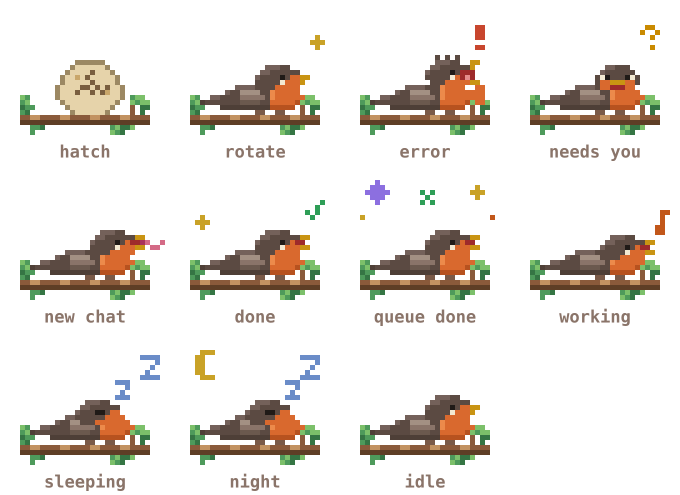
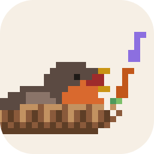
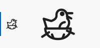
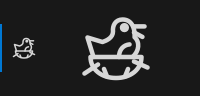
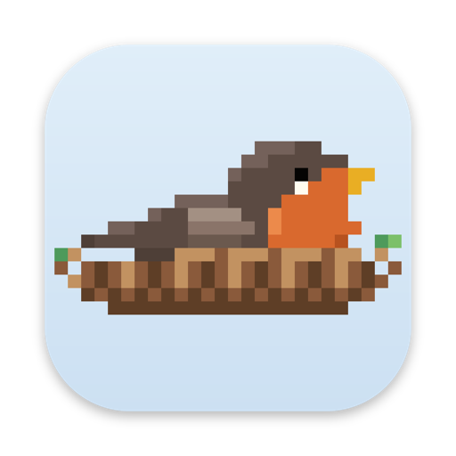
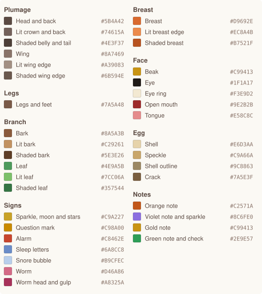
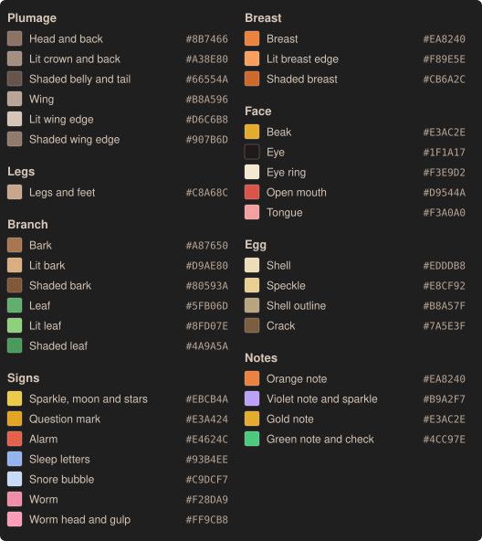

# Robin style sheet

The header robin is pixel art drawn by `media/mascot.js`. Every image on this page is generated from that file by `node scripts/readme/robin.js`, so the page shows exactly what the panel draws. Run the script again after you change the art; a unit test fails while this page is out of date.

## Rules

- Every art pixel is a square. The panel draws 3 CSS pixels per art pixel, with crisp edges.
- The robin sits on a branch 26 pixels wide and 14 pixels tall. Jumps, notes and sparkles stay within 13 pixels above it; only the robin flying away and the egg's cap leave through the top.
- Light comes from the upper left: lit edges on top, shade underneath.
- Only hatch, rotate, needs you, done and queue done take the feet off the branch. In every other state the legs and body stay put and only the head and chest move.
- Breathing lifts the head one pixel and swells the chest one pixel.
- Every state has a still pose with a marker glyph. The panel shows it when **Robin animations** is off or the system asks for reduced motion.
- Colors come from two palettes: one for light themes, one for dark and high contrast themes.

## States

When two states apply at once, the one higher in this table shows. A scene that plays once always plays whole: one that starts while another plays waits for it, and one that a higher state interrupts is skipped.

<table>
<tr><th>Animation</th><th>State</th><th>When it plays</th></tr>
<tr><td><picture><source media="(prefers-color-scheme: dark)" srcset="mascot/state-hatch-dark.svg"></picture></td><td><b>Hatch</b> <code>hatch</code></td><td>The first time Nest opens on a computer. The egg wobbles, cracks and the robin bursts out. Plays once, for 5.3 seconds.</td></tr>
<tr><td><picture><source media="(prefers-color-scheme: dark)" srcset="mascot/state-rotate-dark.svg"></picture></td><td><b>Rotate</b> <code>rotate</code></td><td>A new orchestrator takes over the chain. The robin flies off to the right and a fresh one lands from the left. Plays once, for 4.4 seconds.</td></tr>
<tr><td><picture><source media="(prefers-color-scheme: dark)" srcset="mascot/state-error-dark.svg"></picture></td><td><b>Error</b> <code>error</code></td><td>A chat fails: its fleet record ends with outcome failed, or the CLI reports it failed. The robin squawks with its crest up. Holds for 6 seconds.</td></tr>
<tr><td><picture><source media="(prefers-color-scheme: dark)" srcset="mascot/state-needs-dark.svg"></picture></td><td><b>Needs you</b> <code>needs</code></td><td>While any chat waits for you. The robin faces you, chirps and hops under a question mark until you answer.</td></tr>
<tr><td><picture><source media="(prefers-color-scheme: dark)" srcset="mascot/state-worm-dark.svg"></picture></td><td><b>New chat</b> <code>worm</code></td><td>A new chat starts for a ticket. The robin catches a worm and gulps it down. Plays once, for 4 seconds.</td></tr>
<tr><td><picture><source media="(prefers-color-scheme: dark)" srcset="mascot/state-done-dark.svg"></picture></td><td><b>Done</b> <code>done</code></td><td>A chat ends with outcome done, or a ticket reaches a finished stage. The robin jumps, a check pops up and it sings three notes. Plays once, for 3.5 seconds.</td></tr>
<tr><td><picture><source media="(prefers-color-scheme: dark)" srcset="mascot/state-milestone-dark.svg"></picture></td><td><b>Queue done</b> <code>milestone</code></td><td>Every ticket in the queue is finished. The robin makes two jumps in a ring of sparkles and sings. Plays once, for 4.5 seconds.</td></tr>
<tr><td><picture><source media="(prefers-color-scheme: dark)" srcset="mascot/state-working-dark.svg"></picture></td><td><b>Working</b> <code>working</code></td><td>While chats work. The robin taps along, and each working chat (up to six) sends a note from its beak at a random moment, at most one every 2.5 seconds per chat. Three or more working chats tap faster, six or more faster still.</td></tr>
<tr><td><picture><source media="(prefers-color-scheme: dark)" srcset="mascot/state-sleep-dark.svg"></picture></td><td><b>Sleeping</b> <code>sleep</code></td><td>No chat has worked or waited for you for 10 minutes, outside night hours. The robin tucks its head and snores.</td></tr>
<tr><td><picture><source media="(prefers-color-scheme: dark)" srcset="mascot/state-night-dark.svg"></picture></td><td><b>Night</b> <code>night</code></td><td>No chat has worked or waited for you for 10 minutes, between 10 PM and 6 AM local time. The robin sleeps under a moon and stars.</td></tr>
<tr><td><picture><source media="(prefers-color-scheme: dark)" srcset="mascot/state-idle-dark.svg"></picture></td><td><b>Idle</b> <code>idle</code></td><td>Nothing else applies. The robin breathes, looks around, blinks, peeps, yawns and pecks at the branch.</td></tr>
</table>

## Still poses

The reduced motion pose for each state, with the marker that names it.

  <picture><source media="(prefers-color-scheme: dark)" srcset="mascot/still-dark.svg"></picture>

## Icons

<table>
<tr><th>Icon</th><th>Use</th></tr>
<tr><td></td><td><b>Listing icon</b> <code>media/icon.png</code>, 256 by 256 pixels. Shown in the Extensions view and on the extension page.</td></tr>
<tr><td> </td><td><b>Activity Bar icon</b> <code>media/nest.svg</code>, a 24 pixel line drawing. VS Code paints it in one color, the bar's icon color, so it reads the same in every theme.</td></tr>
<tr><td></td><td><b>Desktop tile</b> <code>docs/mascot/desktop-tile.png</code>, 512 by 512 pixels. For a desktop or dock shortcut; it is not part of the extension.</td></tr>
</table>

## Palette

### Light themes

### Dark and high contrast themes

Palette values

| Group | Role | Light | Dark |
| --- | --- | --- | --- |
| Plumage | Head and back | `#5B4A42` | `#8B7466` |
| Plumage | Lit crown and back | `#74615A` | `#A38E80` |
| Plumage | Shaded belly and tail | `#4E3F37` | `#66554A` |
| Plumage | Wing | `#8A7469` | `#B8A596` |
| Plumage | Lit wing edge | `#A39083` | `#D6C6B8` |
| Plumage | Shaded wing edge | `#6B594E` | `#907B6D` |
| Breast | Breast | `#D9692E` | `#EA8240` |
| Breast | Lit breast edge | `#EC8A4B` | `#F89E5E` |
| Breast | Shaded breast | `#B7521F` | `#CB6A2C` |
| Face | Beak | `#E9AE24` | `#F0BC40` |
| Face | Eye | `#050403` | `#050403` |
| Face | Eye ring | `#FFFCF0` | `#FFFCF0` |
| Face | Open mouth | `#9E2B2B` | `#D9544A` |
| Face | Tongue | `#E58C8C` | `#F3A0A0` |
| Legs | Legs and feet | `#7A5A48` | `#C8A68C` |
| Branch | Bark | `#8A5A3B` | `#A87650` |
| Branch | Lit bark | `#C29261` | `#D9AE80` |
| Branch | Shaded bark | `#5E3E26` | `#80593A` |
| Branch | Leaf | `#4E9A5B` | `#5FB06D` |
| Branch | Lit leaf | `#7CC06A` | `#8FD07E` |
| Branch | Shaded leaf | `#357544` | `#4A9A5A` |
| Egg | Shell | `#E6D3AA` | `#EDDDB8` |
| Egg | Speckle | `#C9A66A` | `#E8CF92` |
| Egg | Shell outline | `#9C8863` | `#B8A57F` |
| Egg | Crack | `#7A5E3F` | `#7A5E3F` |
| Notes | Orange note | `#C2571A` | `#EA8240` |
| Notes | Violet note and sparkle | `#8C6FE0` | `#B9A2F7` |
| Notes | Gold note | `#C99413` | `#E3AC2E` |
| Notes | Green note and check | `#2E9E57` | `#4CC97E` |
| Signs | Sparkle, moon and stars | `#C9A227` | `#EBCB4A` |
| Signs | Question mark | `#C98A00` | `#E3A424` |
| Signs | Alarm | `#C8462E` | `#E4624C` |
| Signs | Sleep letters | `#6A8CC8` | `#93B4EE` |
| Signs | Snore bubble | `#B9CFEC` | `#C9DCF7` |
| Signs | Worm | `#D46A86` | `#F28DA9` |
| Signs | Worm head and gulp | `#A8325A` | `#FF9CB8` |

